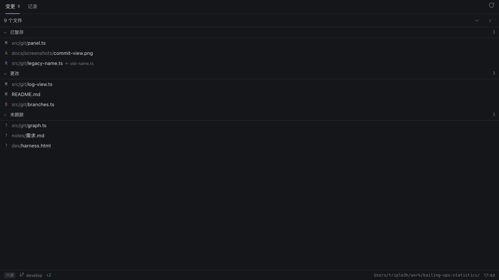
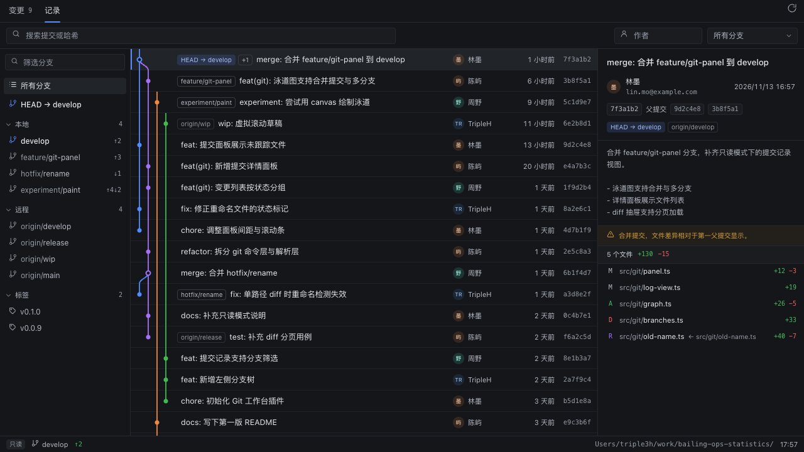

# Git 工作台（ZCode 插件）

只读的 Git 查看器：在 ZCode 右侧栏看工作区变更、文件 diff、分支提交泳道图与提交详情。**不提供任何暂存、提交、推送或回滚操作**——写操作留给后续版本。





## 安装

这个仓库同时是一个只含单个插件的 ZCode 市场（根目录的 `marketplace.json`），所以直接添加仓库地址即可。

**从 GitHub 安装**
1. 打开 **插件市场 → 添加 → 添加插件市场**。
2. 粘贴 `https://github.com/Triple3h/git-workbench`，点添加。
3. 在 **个人 → git-workbench → Git 工作台 → 安装**。
4. 在任意 Git 仓库工作区打开侧栏的 **打开标签页 → Plugins → Git 工作台**。

**本地开发安装**
1. 打开 **插件市场 → 添加 → 添加插件市场**，粘贴本机包含 `marketplace.json` 的目录
   （该目录下同时放着 `git-workbench/` 源码）。
2. 在 **个人 → dev-git-workbench → Git 工作台 → 安装**。

插件按会话打开；`window.zcode` 与 `ui.surfaces` 属于 ZCode 当前版本实际支持、但尚未写入插件文档的接口，升级后若布局/桥接行为变化，需要同步调整 `ui/panel.js` 与 `.zcode-plugin/plugin.json`。

## 功能

**变更**
- 分组：冲突 / 已暂存 / 更改 / 未跟踪，组头可折叠，数量实时更新。
- 行内状态标记（M/A/D/R/C/U/?），重命名显示原文件名。
- 点击文件在底部抽屉查看 diff：双行号、`+/-` 着色、hunk 头、二进制提示。
- 每 3 秒静默刷新状态；看不到 diff 时不会重新拉取，避免打断阅读。

**记录**
- `git log --topo-order --all`，自绘泳道图（分叉、合并、多父、根提交、空心合并点）。
- 提交行按列对齐：泳道 · refs · 标题 · 作者头像与名字 · 相对时间 · 短哈希；窄宽度依次收起作者列、哈希列。
- 左侧分支树：HEAD、本地、远程、标签、ahead/behind，`origin/` 等前缀弱化显示；点击筛选，过滤条下拉同步。
- 顶部过滤条：搜索提交信息/哈希/refs、按作者筛选、按分支下拉筛选，三者可叠加；命中的行高亮，其余行变暗，`Enter` 跳到下一个匹配。
- 提交详情：作者头像、邮箱与时间，哈希复制、父提交、refs、完整信息、合并说明、文件级增删统计。
- 点文件在整页底部抽屉查看该提交内的 diff（合并提交相对第一父提交）。
- 加载更多（每次 120 条，服务端同时按 48 KiB 结构化数据预算截断）。

**通用**
- 跟随 ZCode 暗/亮主题（应用宿主注入的 CSS 变量，不依赖宿主给 iframe 注样式）。
- 窄宽度响应式：分支树改为抽屉，提交详情改为覆盖层；`Esc` 逐层关闭。
- 快捷键：`⌘/Ctrl+R` 刷新，`⌘/Ctrl+1/2` 切换页签，列表内 `↑/↓` 选择提交。
- 状态栏显示只读标记、分支、ahead/behind、仓库路径（可点击复制）与刷新时间。

## 只读

插件的 MCP 服务只注册读取类工具：

| 工具 | 用途 |
| --- | --- |
| `git_status` | 分支、ahead/behind、暂存/未暂存/未跟踪/冲突列表 |
| `git_diff` | 工作区 / 暂存区 / 单个未跟踪文件的 diff（分页） |
| `git_log` | 拓扑序提交、父提交与 refs（分页、可按分支/路径过滤） |
| `git_branches` | 本地/远程分支与标签 |
| `git_commit_detail` | 提交信息与文件增删统计 |
| `git_commit_diff` | 提交内单个文件的 diff（分页） |
| `open_git_panel` | 打开侧栏面板 |

服务端没有任何 `git add/commit/push/reset/restore` 调用；`scripts/check.mjs` 里有对应的静态断言。

## 结构

```
.zcode-plugin/plugin.json   # mcpServers + ui.surfaces（availability: session）
bin/launch.sh               # 先找 PATH/常见路径的 node，再回退 ZCode Helper
server.mjs                  # 入口：工具 + ui:// 资源 + stdio JSON-RPC
lib/mcp.mjs                 # 最小 MCP 实现（initialize/tools/resources）
lib/git.mjs                 # execFile 封装、status/log/branches/numstat/diff 解析
lib/tools.mjs               # 工具定义与 handler
lib/diff.mjs                # diff 分页与统计
ui/panel.html               # 壳：握手、主题、按序注入 CSS/JS
ui/panel.css                # JetBrains 密度样式、双主题、响应式
ui/panel.js                 # 桥接、主题订阅、页签、状态栏、轮询
ui/graph.js                 # 泳道分配 + 每行 SVG
ui/diffview.js              # 统一 diff 渲染（双行号）
ui/changes-view.js          # 变更列表 + diff 抽屉
ui/log-view.js              # 分支树 + 提交列表 + 详情 + diff 抽屉
```

面板通过宿主注入的 `window.zcode` 调用工具与读取资源；服务端只通过 `ui://git-workbench/assets/...` 提供静态文本，不访问网络。

## 开发与验证

```bash
node scripts/smoke.mjs    # 临时仓库端到端：协议、status/log/detail/diff、分页、错误码
node scripts/check.mjs    # manifest、资源、只读断言、语法检查
node /Applications/ZCode.app/Contents/Resources/glm/zcode.cjs plugins validate .
```

离线看 UI（不启动 ZCode）：

```bash
python3 -I -m http.server 8791 --bind 127.0.0.1
# 浏览器打开 http://127.0.0.1:8791/dev/harness.html
# 浅色：?theme=light
```

`dev/harness.html` 注入一个 mock `window.zcode` 与一组合成提交（含合并、侧分支、标签、重命名、二进制、未跟踪文件），用于迭代布局与泳道图。

## 限制

- 只读；暂存/提交/amend/push/pull/stash/分支写操作均不在本版本。
- 以工作区所属仓库根为准，单仓库；不处理多仓库与子模块内的独立改动。
- 合并提交的文件列表与 diff 相对第一父提交，不做合并冲突解决。
- 未跟踪文件的 diff 用 `git diff --no-index -- /dev/null <path>` 合成，空文件没有可显示内容。
- 无语法高亮与 word-level diff；大 diff 按行分页，不做虚拟滚动。
- 状态最多 2000 项、分支/标签最多 500 个、提交详情文件最多 800 个，超出会提示截断。
